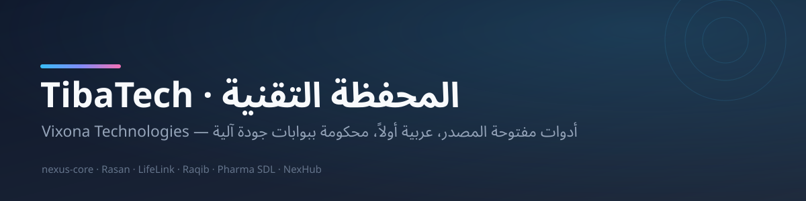
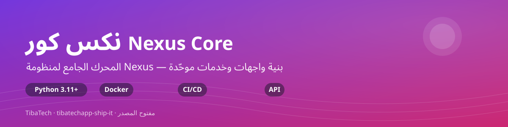
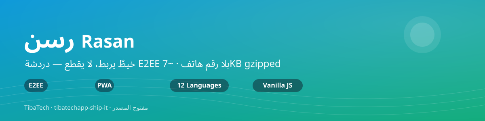
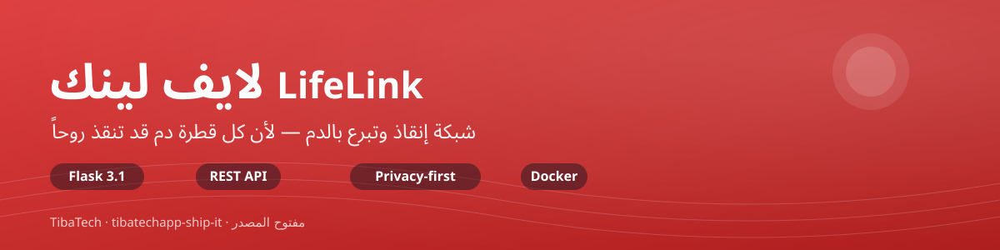
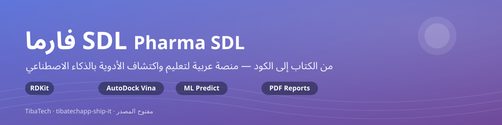
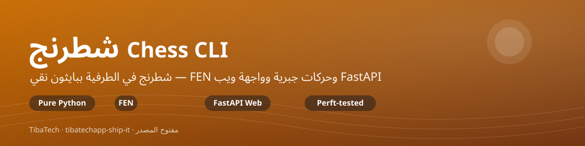
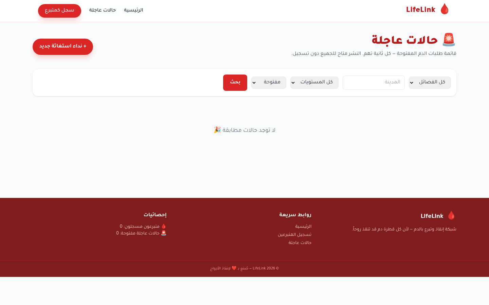

  <picture>
    
  </picture>

# TibaTech — المحفظة التقنية | Tech Portfolio

> بنينا أدوات **نستخدمها نحن أولاً** — ثم فتحناها للعالم. كل مشروع هنا مفتوح المصدر، عربي في صميمه، ومحكوم ببوابات جودة آلية.

  
  
  
  

---

## 🚀 المشاريع النشطة | Active Projects

| المشروع | ما هو | المجال | الحالة |
|---|---|---|---|
| **[Nexus Core](https://github.com/tibatechapp-ship-it/nexus-core)** | نظام وكلاء AI موحّد: ذاكرة + تعلّم + أمن + 20 وكيل | 🧠 AI Framework | `v1.9.3` |
| **[Rasan — رسن](https://github.com/tibatechapp-ship-it/Rasan)** | دردشة E2EE بلا رقم هاتف — ~7KB gzipped | 💬 Communication | `PWA` |
| **[LifeLink](https://github.com/tibatechapp-ship-it/lifelink-app)** | شبكة إنقاذ وتبرع بالدم — خصوصية أولاً | 🩸 Health | `v1.0.0` |
| **[Raqib — راقب](https://github.com/tibatechapp-ship-it/raqib)** | لوحة تحليلات فورية بـRunbooks ذكية (لا تنفّذ أوامر) | 📊 Analytics | `v0.4.3` |
| **[Pharma SDL](https://github.com/tibatechapp-ship-it/pharma-sdl)** | منصة عربية لتعليم واكتشاف الأدوية بالذكاء الاصطناعي | 🧬 Biotech Edu | `sprint 8` |
| **[NexHub](https://github.com/tibatechapp-ship-it/nexhub)** | منصة Git محلية عربية — بلا حساب، بلا سحابة | 🛠️ Developer Tool | `v0.3.0` |
| **[Chess CLI](https://github.com/tibatechapp-ship-it/chess-cli)** | شطرنج الطرفية ببايثون نقي + واجهة ويب FastAPI — وُلد من Nexus Studio | ♟️ Showcase | `0.1.0` |

### 🎯 التركيز الحالي — النواة الخمسة | Core Five

> مراجعة محفظة 2026-10-31 خلصت إلى: **القيمة في التركيز**. هذه الخمسة تحصل على الجهد الهندسي الكامل؛ ما عداهم إما داعم أو مؤرشف.

| الترتيب | المشروع | فكرة | تنفيذ | سوق | جاهزية | المركّب | الفجوة الوحيدة نحو المنتج |
|---|---|---|---|---|---|---|---|
| 1 | **Nexus Core** | 9.5 | 8.5 | 8.5 | 6.5 | **8.2** | لوحة تحكم + trace logs + benchmarks + demo |
| 2 | **Rasan — رسن** | 9.0 | 8.5 | 8.0 | 6.0 | **7.9** | نشر على المتاجر (APK/AAB) + MLS الجماعي + اختبار ميداني |
| 3 | **LifeLink** | 8.5 | 7.5 | 7.5 | 5.5 | **7.2** | مطابقة متبرعين جغرافية + وثائق ثقة/خصوصية للمشغّل |
| 4 | **NexHub** | 8.0 | 7.5 | 7.0 | 5.5 | **7.0** | قرار هوية المنتج: **مساحة عمل تطوير محلية عربية** ثم UX للسرد |
| 5 | **BASIRAH-AI — بصيرة** | 8.5 | 6.5 | 7.5 | 5.0 | **6.8** | التحول من pipeline إلى platform: بحث دلالي + لوحة بيانات وصفية |

> **منهجية الدرجات**: كل رقم خلفه دليل قابل للتحقق (عدد الاختبارات، حالة CI، الميزات الموثقة في CHANGELOG) — راجع تقرير المراجعة الكامل. التنفيذ يشمل: `nexus-core` (CI ثلاثي + 173 مدخلاً في tests/ + 1,800+ اختبار آلي وفق وصف المنظمة)، `Rasan` (312 اختبار: 265 خادم + 47 جوال)، `lifelink-app` (70 اختبار + ترحيلات idempotent على Postgres حقيقي)، `nexhub` (analyze صفر + 38 اختبار + نشر Pages)، `BASIRAH-AI` (Docker stack كامل + OCR/ML).

### 🧱 الطبقات الأخرى | Other Tiers

- **درجة ثانية قريبة من النواة**: [Raqib](https://github.com/tibatechapp-ship-it/raqib) (E2E + Integration Postgres أخضر + ADRs — ينقصه قصة سوق) و[Pharma SDL](https://github.com/tibatechapp-ship-it/pharma-sdl) (إصدارات سطح مكتب 3 منصات — يحتاج فريق بحث وبيانات).
- **مكوّنات داعمة**: [qubhub telemetry](https://github.com/tibatechapp-ship-it/qubhub) (خادم إحصاءات يحترم الخصوصية — جزء من منظومة QubHub لا منتج مستقل).
- **أرشيف موحّد**: `wifi-chat` → وحدة sila داخل رسن · `NexunGu` → qubhub · `tyb-zyv-ai` → nexus-core · `novasphere` مؤرشف · `olmo` مُدمج في NexHub · `seekfeek` fork لمرجع DeepSeek Harness.

### 📊 شارات المشاريع | Project Badges

| المشروع | CI | الترخيص | الإصدار | التقنية |
|---|---|---|---|---|
| **Nexus Core** |   |  |  |  |
| **Rasan** |  |  | — |  |
| **LifeLink** |  |  |  |  |
| **Raqib** |  |  |  |  |
| **Pharma SDL** |  |  | — |  |
| **NexHub** |   |  |  |  |
| **Chess CLI** |  |  | — |  |

---

## 🖼️ المشاريع بنظرة | Projects at a Glance

<table>
  <tr>
    <td width="50%">
      
      
المحرك الجامع لمنظومة Nexus

    </td>
    <td width="50%">
      
      
دردشة E2EE بلا رقم هاتف

    </td>
  </tr>
  <tr>
    <td width="50%">
      
      
شبكة إنقاذ وتبرع بالدم

    </td>
    <td width="50%">
      
      
تحليلات فورية بلا تنفيذ أوامر

    </td>
  </tr>
  <tr>
    <td width="50%">
      
      
اكتشاف الأدوية بالذكاء الاصطناعي

    </td>
    <td width="50%">
      
      
منصة Git محلية عربية

    </td>
  </tr>
  <tr>
    <td width="50%">
      
      
شطرنج الطرفية — وُلد من Nexus Studio

    </td>
    <td width="50%">
      
<b>… والمزيد قادم</b>

      
<a href="https://github.com/orgs/tibatechapp-ship-it/repositories">تابع المنظمة</a> ليصلك الجديد

    </td>
  </tr>
</table>

---

## 📸 لقطات حقيقية | Real Screenshots

من LifeLink كما هو — بلا تجميل، من جلسات تشغيل فعلية:

<table>
  <tr>
    <td width="50%">
<b>الرئيسية</b> — قوائم PII-minimal
</td>
    <td width="50%">
<b>النداءات الاستعجالية</b> — رحلة تعمل للزائر
</td>
  </tr>
</table>

---

## 🕒 آخر تحديث | Last Updated

<!-- LAST-UPDATED:START -->
| المشروع | آخر دفعة (UTC) | فرع نشط |
|---|---|---|
| Rasan | 2026-10-30 | main |
| lifelink-app | 2026-10-29 | main |
| pharma-sdl | 2026-10-30 | main |
| nexhub | 2026-10-30 | main |
| nexus-core | 2026-10-29 | main |
| chess-cli | 2026-10-30 | main |
| raqib | 2026-10-30 | main |
<!-- LAST-UPDATED:END -->

> 🤖 هذا الجدول يتحدّث **تلقائياً** كل 6 ساعات عبر GitHub Actions (`.github/workflows/update-readme.yml`) — لا تعدّله يدوياً.

---

## 🧭 مبادئنا | Principles

- **الخصوصية ليست ميزة تُضاف** — بل تُصمَّم من السطر الأول (Rasan بلا أرقام، NexHub بلا سحابة، LifeLink بقوائم PII-minimal)
- **عربي أولاً ثم العالم** — RTL أصلي، لا ترجمة لاحقة
- **بوابات لا وعود** — CI يعمل على main، والاختبارات شرط للدمج
- **صدق التقدم** — لا عدّادات وهمية ولا بيانات مختلقة، والمحدوديات تُعلَن في التوثيق

## 📬 التواصل

- 🏢 المنظمة: [tibatechapp-ship-it](https://github.com/orgs/tibatechapp-ship-it/repositories)
- 🔐 ثغرة أمنية في أحد المشاريع؟ استخدم **Security Advisories** في المستودع المعني — لا Issues عامة.
